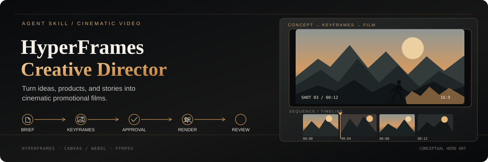

<p align="center">
  
</p>

<p align="center">
  <strong>An Agent Skill for cinematic video production with HyperFrames.</strong><br />
  Turn ideas, products, articles, and stories into promotional films through a content-led creative workflow.
</p>

<p align="center">
  <a href="https://github.com/heygen-com/hyperframes">HyperFrames</a> ·
  <a href="https://hyperframes.heygen.com/introduction">Documentation</a> ·
  <a href="LICENSE">AGPL-3.0-only</a>
</p>

## What it does

**HyperFrames Creative Director** helps a coding agent take a film from an initial idea to a reviewed export. The content drives the creative direction; the workflow keeps important decisions visible and the final deliverable inspectable.

- **Content-led direction.** Develop a concept, narrative, shots, copy, and sound direction from the actual source material.
- **Review before production.** Prepare one brief and actual keyframe images for approval before full animation and rendering.
- **Flexible visual techniques.** Combine HTML/SVG, Canvas/WebGL, Three.js, generated or licensed media, and sound when they serve the concept.
- **Reproducible workflow.** Use HyperFrames for composition, timing, preview, and export, with isolated workspaces for individual films.
- **Final-file QA.** Inspect the exported MP4, extract frames and continuous excerpts, and record review evidence against the delivered file.
- **Honest review status.** Distinguish technical checks, self-review, and independent review; mark unavailable playback or listening checks as unverified.

No fixed visual style, mandatory shot count, or generated-asset quota. The creative approach should fit the story.

The optional [craft library](skills/hyperframes-creative-director/references/craft-library.md) connects content to typography, product evidence, lighting/materials, masks/transitions, spatial 3D and motion/sound. Its [vocabulary index](skills/hyperframes-creative-director/references/craft-index.md) preserves issue-derived ideas and their evidence status; twelve detailed entries and six paired [source studies](skills/hyperframes-creative-director/examples/craft-studies/README.md) provide execution paths. Reuse, adapt, combine, invent, or use no catalog reference. Dark cinema is one possible recipe.

The new studies and audio measurement fixtures are authored but **not yet runtime or visually verified**. Automated tests, renders and the eight-film pilot are paused at the user's request. No quality improvement is claimed from source completion. See the [evidence and issue dispositions](docs/research/craft-evidence.md) and [pilot protocol](evals/README.md#craft-upgrade-pilot).

## Install

Requirements: Node.js 22 or newer. Video production and integration checks may also need the official HyperFrames runtime, a compatible browser, and FFmpeg/ffprobe.

```bash
# Install this Agent Skill
npx skills add geekjourneyx/hyperframes-creative-director

# Install the official HyperFrames skills
npx skills add heygen-com/hyperframes
```

The second command installs skills; it does not, by itself, verify that the CLI, browser, or media tools are ready. Check the installed HyperFrames version's requirements before production.

## Make your first film

Ask your coding agent:

> Turn this product README into a 30-second promotional film. First show me one creative brief and the actual keyframes for approval. Use whichever visual techniques fit the content.

The agent checks the environment and creates a separate workspace:

```bash
npx hyperframes init my-video
cd my-video
npx hyperframes preview
npx hyperframes render
```

Choose the duration and aspect ratio in the brief. English is the default output language; request another language explicitly when needed. Full animation and production rendering wait until the brief and displayed keyframes are approved. Concept sketches and keyframe previews can be prepared beforehand.

For an agent-managed preview handoff, the tested CLI also supports:

```bash
npx hyperframes preview --background
npx hyperframes preview --status
npx hyperframes preview --stop
```

Check the installed CLI's help for version-specific options.

## The workflow

1. **Understand.** Read the source, audience, key message, factual claims, and desired response.
2. **Direct.** Create one brief covering the concept, narrative, copy, shot direction, and sound.
3. **Review keyframes.** Generate and inspect actual keyframe images, then ask the user to approve the brief and images together.
4. **Produce.** Use HyperFrames for timing, composition, preview, and export; add Canvas/WebGL or other techniques when useful.
5. **Inspect.** Review the exported MP4, including actual frames, continuous motion, sound, and source fidelity.
6. **Deliver.** Provide the video, reproducible project, brief, keyframes, media provenance, and an honest review summary.

Material changes to the approved direction require renewed approval. Never fabricate user approval, playback observations, media provenance, or independent review.

## Quality helpers

Run the helper's command-line interface from any directory:

```bash
node <installed-skill>/scripts/director.mjs help
```

Resolve the installed skill directory from the host's skill entry; it is not necessarily the repository path. The helpers use Node.js and installed media/HyperFrames tools, without a separate npm install inside the skill directory.

| Command | Purpose |
| --- | --- |
| `doctor --workspace PATH` | Inspect dependencies without downloading them |
| `init --parent PATH --name my-video` | Create an isolated HyperFrames workspace |
| `submit --workspace PATH` | Decode actual keyframe images and record the brief digest |
| `approve --workspace PATH --confirmation confirmation.json` | Record a user confirmation after keyframe review |
| `check-approval --workspace PATH` | Reject stale brief or image approval |
| `render --workspace PATH --output final.mp4` | Check approval and invoke the official renderer |
| `inspect --workspace PATH --video final.mp4` | Inspect the final file and extract frames and excerpts |
| `delivery --workspace PATH --review .director/review.json` | Check hashes, provenance, approval, and review completeness |

The review records are workflow evidence, not authenticated user identities or a sandbox around the official CLI. A technical pass cannot prove artistic merit or override the user's rejection.

## Design principles and limits

- **Content before effects.** Choose visual language, pacing, camera, music, and techniques to serve the material.
- **Human approval at the right point.** Full production follows review of the actual brief and keyframes.
- **Evidence over assumptions.** A screenshot sheet cannot verify timing or sound; unavailable checks remain unverified.
- **Traceable media.** Track source and rights information for external assets. Lightweight provenance records do not establish legal authorization.
- **No false guarantees.** Automated checks catch some technical issues, not every valid-but-visually-wrong export.

## Development

```bash
npm ci
npx playwright install chromium
npm test
npm run test:integration
npm run check:package
```

Install FFmpeg/ffprobe using your OS package manager. Integration checks require Chromium and FFmpeg; `CHROMIUM_PATH` can select an existing compatible Chromium executable. Missing tools fail integration tests rather than counting as a successful render.

The implementation baseline is HyperFrames 0.8.174 and Node.js 22+. Linux is exercised locally; the CI matrix also targets macOS, whose result should be checked on an actual run. Browser and GPU differences may affect pixels. Canvas/WebGL integration tests verify repeatability within one renderer, not universal bit-exact output. See the [evaluation protocol](evals/README.md) for controlled comparisons; no creative pilot or holdout benchmark has established a win rate.

New font/texture/WebGL failure fixtures await execution. Stateful simulations and valid-but-visually-wrong exports still need additional coverage and real visual review. Synthetic test approvals do not count as real-user approval, and test results do not certify creative quality or audience response.

Official references: [HyperFrames](https://github.com/heygen-com/hyperframes) and its [documentation](https://hyperframes.heygen.com/introduction). Runtime behavior is version-sensitive; inspect the installed CLI and official skills when upgrading.

Local video projects, evaluation runs, and `docs/superpowers/` are excluded from source control and release packages.

## Author

- Website: [jieni.ai](https://jieni.ai/)
- GitHub: [geekjourneyx](https://github.com/geekjourneyx)
- X: [@seekjourney](https://x.com/seekjourney)
- WeChat Official Account: 极客杰尼

## License

This project is licensed under the [GNU Affero General Public License v3.0](LICENSE) (AGPL-3.0-only).

Third-party media, dependencies, and tools retain their respective licenses.
